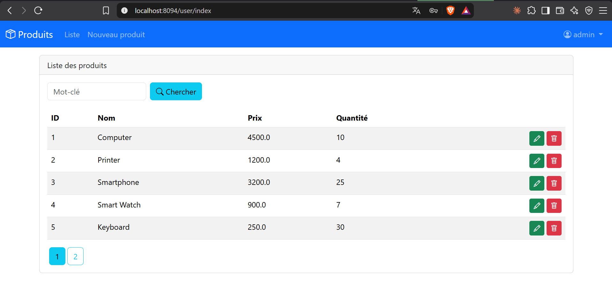
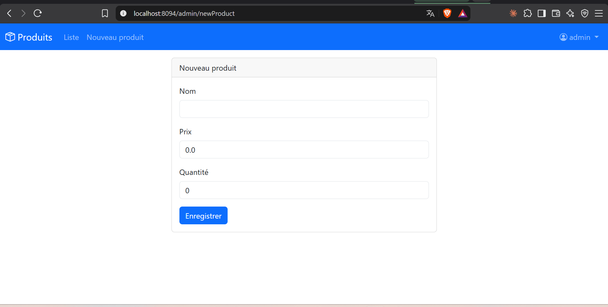

# Activité Pratique N°3 – Spring MVC, Thymeleaf, Spring Security

Cours : Architecture JEE et Java avancé – Mundiapolis 2026

**Stack :** Spring Boot 3.4 · Java 17+ · Spring Web · Spring Data JPA · Hibernate · H2 / MySQL ·
Thymeleaf + Layout Dialect · Bootstrap 5 · Spring Security · Spring Validation · Lombok

## Objectif
Application web JEE de gestion de produits basée sur Spring MVC, Spring Data JPA,
Hibernate, Thymeleaf et Spring Security.

## Étape 1 – Création du projet
Projet Spring Boot (Maven, Java 17) avec les dépendances : Spring Web, Spring Data JPA,
H2, MySQL Driver, Thymeleaf, Lombok, Spring Security, Spring Validation.
Ajouts : Thymeleaf Layout Dialect, Thymeleaf Extras Spring Security, Bootstrap et
Bootstrap Icons (WebJars).

`application.properties` : base H2 en mémoire (MySQL en commentaire), port 8094.

## Étape 2 – Entité JPA `Product`
Attributs : `id` (Long, clé primaire auto-générée), `name`, `price`, `quantity`.
Lombok génère getters/setters, constructeurs, builder et `toString()`.

## Étape 3 – Interface `ProductRepository`
`ProductRepository` hérite de `JpaRepository<Product, Long>` : Spring Data fournit
automatiquement les opérations CRUD.

## Étape 4 – Test de la couche DAO
Un `CommandLineRunner` insère 6 produits au démarrage puis les affiche dans la console
(requêtes SQL visibles grâce à `spring.jpa.show-sql=true`).

## Étape 5 – Désactivation de la protection par défaut de Spring Security
Spring Security protège toutes les pages dès qu'il est dans le classpath. Pour développer
les vues, la configuration automatique est exclue :
`@SpringBootApplication(exclude = SecurityAutoConfiguration.class)`.
Elle sera réactivée à l'étape 7.

## Étape 6 – Contrôleur Spring MVC et vues Thymeleaf

### 6.1 Liste des produits et suppression
`ProductController` (`@Controller`) :
- `GET /index` : récupère une page de produits (`PageRequest`) et la passe à la vue `products.html` ;
- `POST /delete` : supprime un produit puis redirige vers la liste (avec confirmation JavaScript).

La vue affiche les produits dans un tableau Bootstrap avec une pagination.

### 6.2 Page template (Thymeleaf Layout + Bootstrap)
`layout1.html` contient la structure commune (barre de navigation Bootstrap) et un
fragment `content1`. Les autres pages s'y insèrent avec `layout:decorate="~{layout1}"`.

### 6.3 Saisie et ajout d'un produit avec validation
- Contraintes sur l'entité : `@NotEmpty @Size(min=3, max=50)` sur `name`, `@Min(0)` sur `price`,
  `@Min(1)` sur `quantity`.
- `GET /newProduct` affiche le formulaire `new-product.html` (`th:object`, `th:field`).
- `POST /saveProduct` valide le produit avec `@Valid` ; en cas d'erreur, le formulaire est
  réaffiché avec les messages (`th:errors`), sinon le produit est enregistré.

